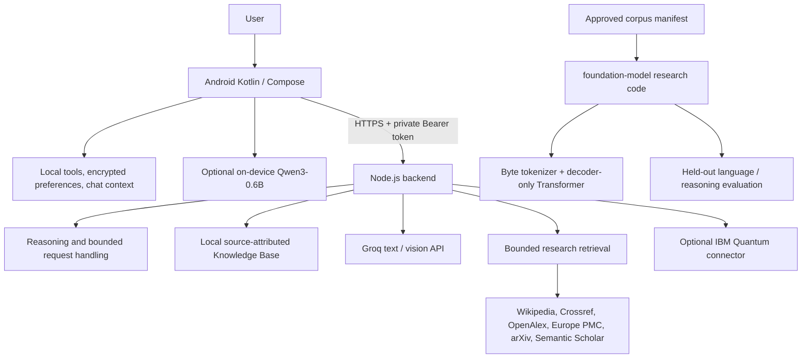

# QUANTUM AI — Architecture and Dependency Review

**Creator by Bittu Pandit**  
**Review date:** 2026-11-18  
**Reviewed branch:** `main` after PR #55, PR #56 and PR #57 merges

## 1. Architecture boundary

QUANTUM AI currently has two distinct AI paths:

1. **Product assistant path:** Android app → private HTTPS backend → configured Groq text/vision model, with local app tools, local memory/context and an optional third-party Qwen offline text model.
2. **Independent-model research path:** `foundation-model/` → original small decoder-only Transformer and UTF-8 byte tokenizer → governed corpus/training/evaluation tools.

The research Transformer is not currently the production chat model. The Groq model and Qwen model are external provider/third-party models, not QUANTUM AI-owned trained weights. The architecture must keep those identities separate in the UI, metrics and release claims.

## 2. System map

The diagram is a code-level dependency map. It does not claim that external providers, IBM Quantum hardware, offline inference or physical-device behavior are currently available in every environment.

## 3. Android application layer

**Entry point and UI**
- Main activity and Compose screens are in `app/src/main/java/com/bittupandit/astraquantumai/`.
- `MainActivity.kt` owns the main chat/navigation flows and calls the configured HTTPS backend routes.
- The app uses the existing package/application ID `com.bittupandit.astraquantumai`. This is a compatibility anchor for in-place Android updates and app-private data; it is not the user-facing product name. Do not rename it as a cosmetic cleanup.

**Local capabilities**
- `ContextIntelligence.kt`: bounded selection of recent and lexically relevant older chat turns, with key numbers/units preserved where possible.
- Encrypted app-private preferences: chat history, notes/projects, opt-in personal context and private backend token. The user controls whether personal context is attached to outbound prompts.
- Deterministic local calculators and science helpers: bounded arithmetic expression parsing, selected science calculations, formula catalogs and unit conversion.
- `PdfOcrExtractor.kt`: bounded on-device Latin/Devanagari OCR fallback for scanned PDFs; quality and runtime still require real-device acceptance.
- `QuantumSimulator.kt`, `QuantumCircuitLab.kt`, `Quantum64SparseLab.kt`: educational classical simulation. A real QPU connection is a separate IBM connector path.

**Offline model**
- `OfflineAiEngine.kt` integrates Google LiteRT-LM Android runtime 0.19.0 with the third-party `litert-community/Qwen3-0.6B` dynamic INT4 artifact (about 328 MiB).
- Download is user-initiated and stored app-private; the code includes integrity checks and GPU-to-CPU fallback.
- It is text-only. Offline vision, guaranteed offline speech and offline document reasoning are not implemented.
- A source-level downloader and CI build do not prove successful download, initialization, latency or airplane-mode inference on the user's phone.

## 4. Backend and external services

**Runtime**
- `backend/server.js` is a Node.js HTTP service using ES modules; `backend/package.json` requires Node.js 20.16 or newer.
- `APP_ACCESS_TOKEN` protects private routes; `GROQ_API_KEY` remains server-side. The backend uses bounded JSON/request handling, timing-safe bearer-token comparison, per-client rate limits, response-size limits and explicit safe-fetch host/redirect rules.

**HTTP interface**
- `GET /health`: minimal health response.
- `POST /v1/generate` and `POST /v1/analyze`: text generation and supported image/PDF processing.
- `POST /v1/research`: bounded scholarly/public-source retrieval and model-assisted synthesis.
- `GET /v1/quantum/backends`, `GET /v1/quantum/jobs/:id`, `POST /v1/quantum/demo`: optional IBM Quantum connector; job submission is separately gated and requires server-side credentials/configuration.

**Configured AI provider**
- Default text model identifier: `openai/gpt-oss-20b` (overridable with `GROQ_MODEL`).
- Default vision model identifier: `qwen/qwen3.8-27b` (overridable with `GROQ_VISION_MODEL`).
- These are Groq-served provider model identifiers, not QUANTUM AI-owned weights.

**Research sources**
- The backend has bounded retrieval adapters for Wikipedia, Crossref, OpenAlex, Europe PMC, arXiv and Semantic Scholar.
- Research ranking, DOI/title matching, limited open-access full-text retrieval and evidence labels are model-assisted. Coverage varies; this is not exhaustive browser search or independent proof of claims.
- External APIs have their own availability, terms, quotas and rate limits.

## 5. Knowledge Base and RAG

- `knowledge-base/schema/knowledge-record.schema.json` defines source-attributed records.
- `knowledge-base/seed/foundations.jsonl` contains 22 starter records in Hindi and English; `sources/source-registry.json` records the source registry.
- Backend `knowledge.js` uses bounded local lexical retrieval and citation validation. This is not semantic/vector search; broad paraphrase and transliteration retrieval remain limitations.
- `knowledge-ingest.js` collects bibliographic metadata into an unreviewed inbox; it does not automatically approve or inject records into the searchable seed corpus.
- Knowledge records are retrieval data, not neural-network weights.

## 6. Independent Foundation Model Lab

- `foundation-model/core.py`: original compact decoder-only Transformer, causal self-attention, pre-normalized blocks, tied embeddings and safe checkpoint loading.
- `ByteTokenizer`: UTF-8 byte tokenizer with PAD/BOS and 258-token vocabulary. Hindi/English/emoji round-trip is unit-tested, but byte-level token efficiency is not yet benchmarked against subword tokenizers.
- `train.py`: governed next-byte training loop with gradient clipping, deterministic validation windows, best-validation checkpoint selection and dataset provenance.
- `datasets/prepare_corpus.py`: deterministic normalization/deduplication/splitting and manifest-draft generation. Generated records remain pending/not-permitted until human review.
- `datasets/validate_manifest.py`: enforces purpose, approval, split, source metadata and SHA-256.
- `evaluate.py` and `evaluate_reasoning.py`: held-out byte-level and exact-match task evaluation harnesses.
- Current `datasets/manifest.json` has an empty dataset list. Therefore no real corpus is approved, no real pretraining run has been completed and no independent-model capability score exists.
- This small randomly initialized research model is not the deployed chat model and must not be represented as a GPT-level assistant.

## 7. Build, CI and release boundaries

| Workflow | Trigger / validation | What a pass establishes |
|---|---|---|
| `.github/workflows/capability-ci.yml` | Relevant PRs: backend install/audit/tests, build/navigation inventory checks, native patch smoke tests, Android unit tests, lint and debug APK | Automated tests and build for that PR head; not phone acceptance or production health |
| `.github/workflows/foundation-model-ci.yml` | PR/push touching `foundation-model/**`: CPU PyTorch and complete Python unit suite | Foundation Model Lab unit-test behavior; not model training quality |
| `.github/workflows/android-build.yml` | Main pushes matching app/backend/build workflow paths; debug build; signed release/publish steps require explicit workflow input and signing secrets | CI debug artifact; signed Release only when separately approved and configured |

Build environment observed in Gradle configuration: Java 17, Gradle 8.9, Android compile SDK 35. The Android build workflow currently does not trigger solely for `foundation-model/**` changes because that path is not in its push filter.

## 8. Critical dependencies, compatibility anchors and gaps

| Item | Current state | Engineering consequence |
|---|---|---|
| Android package/application ID | `com.bittupandit.astraquantumai` | Preserve for update lineage; a rename requires a deliberate migration and separate app identity. |
| Backend URL | `https://astraquantum-ai.onrender.com` | Legacy Render endpoint is embedded as the default; migrate only with a coordinated backend/app config and health verification. |
| Backend secrets | `GROQ_API_KEY`, `APP_ACCESS_TOKEN`, optional IBM secrets | Keep in server environment only; never commit to Git or bundle in APK. |
| Production model identity | Groq provider + optional third-party Qwen offline | Not a QUANTUM AI-owned trained foundation model. |
| Training data | Manifest currently empty | Actual training is blocked until suitable data is sourced, rights/privacy/quality reviewed and explicitly approved. |
| Evaluation data | No approved held-out artifact registered | No independent benchmark score can yet be reported. |
| Knowledge retrieval | 22-record seed and lexical search | Limited coverage; not a comprehensive multilingual semantic RAG system. |
| Real-device acceptance | Not established by repository CI | Install/update, offline model, OCR/voice, battery, memory and thermal behavior need a physical-device test. |
| Autonomous external actions | Task planning/checkpointing exists; broad external-app automation does not | Any future consequential action needs a scoped integration, preview and explicit confirmation. |
| Public release | Release publication requires explicit approval | Do not deploy or publish a Release without the owner's approval. |

## 9. Architecture review conclusion

The product app, backend, local knowledge retrieval, selected deterministic tools and separate Foundation Model Lab are identifiable and have automated test coverage. The most important architectural boundary is that the current assistant's online/offline models are external, while the original QUANTUM AI Transformer remains a research prototype. The next critical dependencies are lawful approved Hindi/English/code corpora, reproducible training compute, held-out evaluation, safety testing and physical-device verification.
